
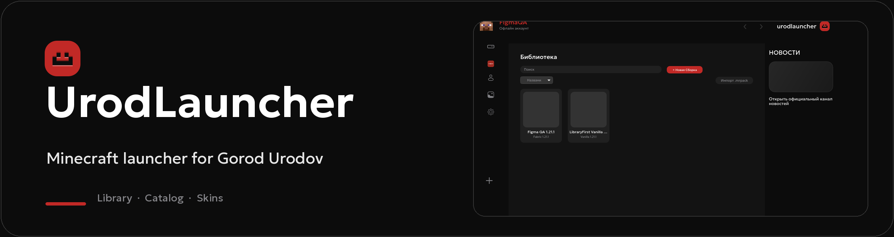

<strong>Your packs, content and skins in one launcher for Gorod Urodov and your own worlds.</strong>

<a href="README.md">Русский</a> · <a href="docs/FIGMA_IMPLEMENTATION_MAP.md">Figma implementation</a> · <a href="docs/TEST-REPORT.md">Test results</a>

UrodLauncher **1.0.0 Stable** is the official release. See [tested scope and remaining limitations](docs/STABLE_1.0.0_AUDIT.md).

## Download 1.0.0 Stable

  <a href="https://github.com/Yozekkk/urod-launcher/releases/download/v1.0.0/UrodLauncher-Setup-1.0.0.exe">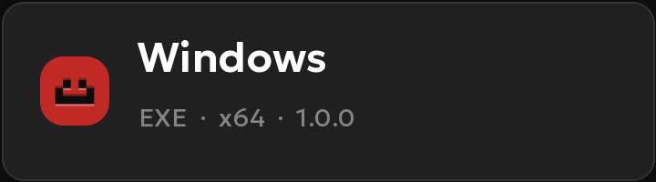</a>
  <a href="https://github.com/Yozekkk/urod-launcher/releases/download/v1.0.0/UrodLauncher-1.0.0-amd64.deb">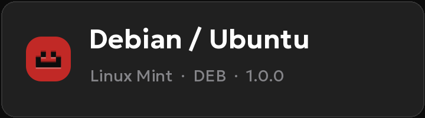</a>
  <a href="https://github.com/Yozekkk/urod-launcher/releases/download/v1.0.0/UrodLauncher-1.0.0-x86_64.pkg.tar.zst">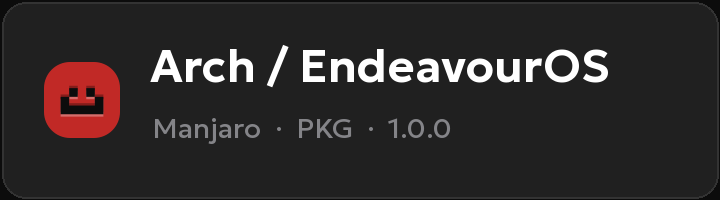</a>

The buttons download installers from the [official v1.0.0 release](https://github.com/Yozekkk/urod-launcher/releases/tag/v1.0.0). Compare each file with [SHA256SUMS.txt](https://github.com/Yozekkk/urod-launcher/releases/download/v1.0.0/SHA256SUMS.txt). Windows packages are not Authenticode signed; in-app automatic updates remain disabled.

## Library opens first

Every launch opens the Library. Create a pack, choose Vanilla, Fabric, Forge, NeoForge or Quilt, install Minecraft, start and stop the game, and find, sort, import or export your packs.

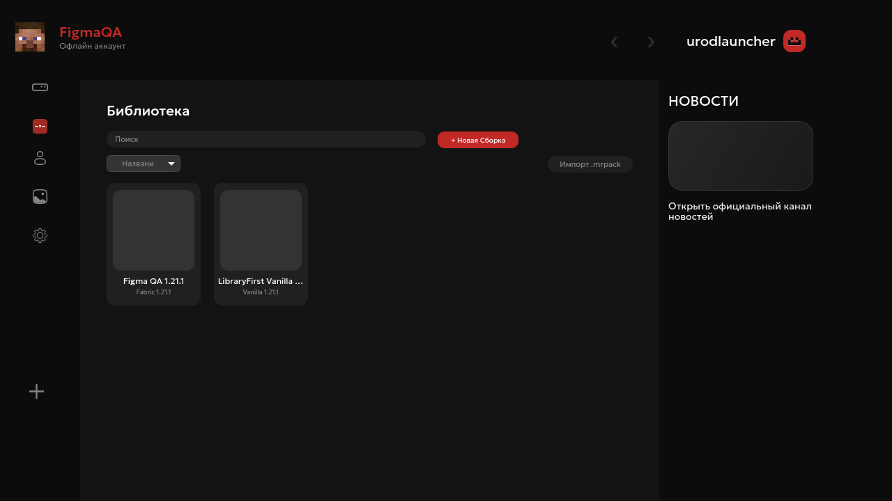

Captured from the running Tauri app at 1280×720 with isolated test data. Blank cover slots belong to packs without custom icons.

## Features

| Catalog | Accounts |
| --- | --- |
| 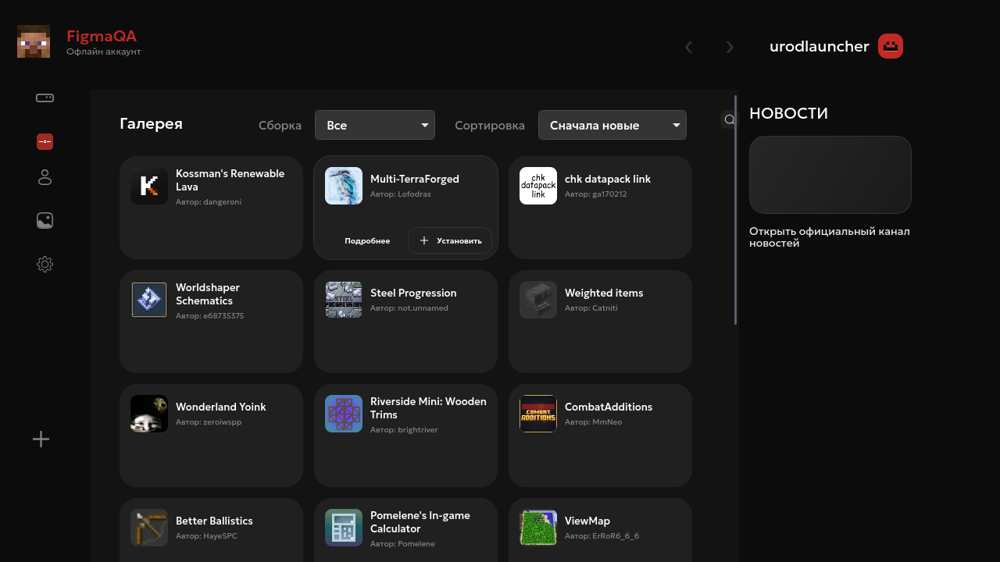 | 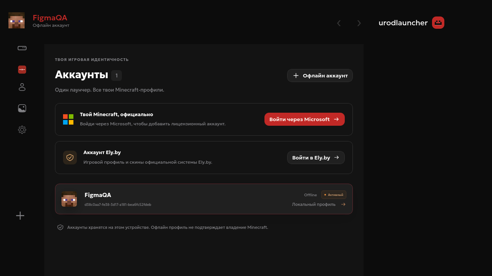 |
| Browse Modrinth mods, shaders, resource packs and modpacks. Compatibility filters use the Minecraft version and loader. | Microsoft, Ely.by and Offline profiles can be stored and switched. Live sign-in is not claimed as tested without authorized credentials. |

A selected pack has installed-content controls, a game log, Java and memory settings. The engine verifies download hashes and supports cancellation and recovery where implemented.

## Skins

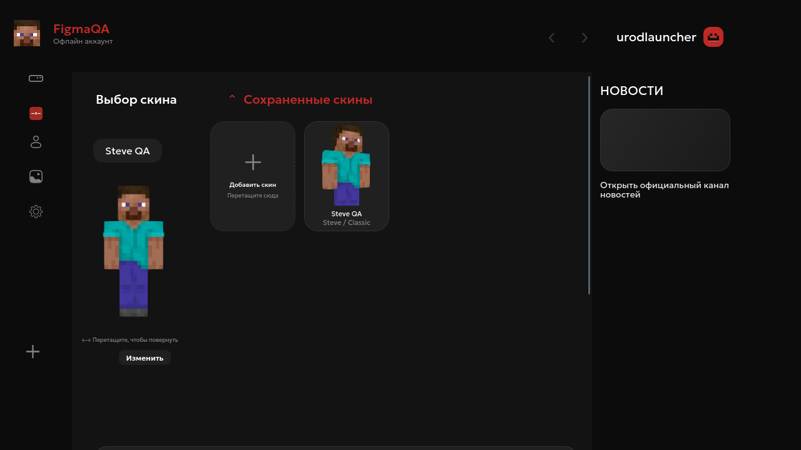

Import a 64×64 or 64×32 PNG up to 1 MB, choose Classic/Steve or Slim/Alex, rotate the 3D model, rename a skin or replace its texture. Per-account application history persists on disk.

View skin history

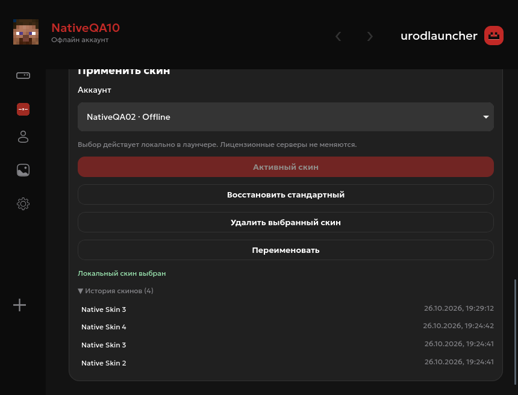

Offline skins are applied locally in the launcher. For Microsoft accounts, the native process uploads the PNG to Minecraft Services and checks the profile response; a real licensed-account upload has not yet been verified. Ely.by skin upload is unavailable in the app.

## Settings and customization

| Figma-based settings | Additional customization |
| --- | --- |
| 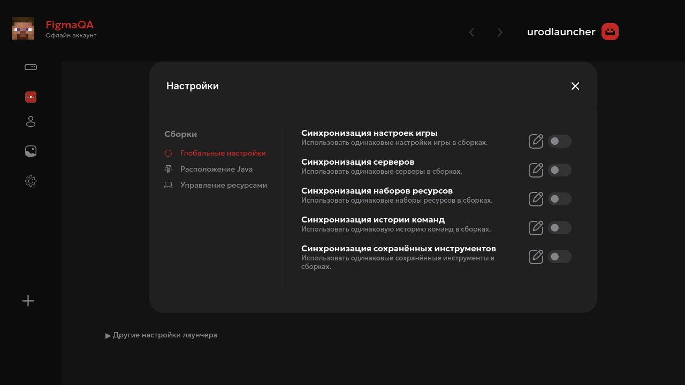 | 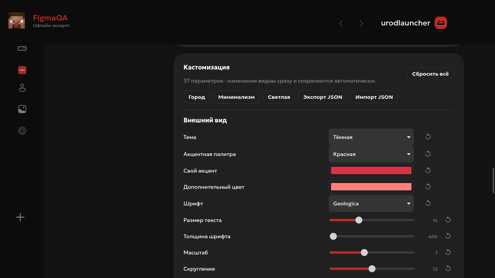 |

Global settings cover Java detection, memory and window dimensions, resource management and concurrent downloads. Packs can override Java and window dimensions. The additional editor exposes 37 customization controls; three old Home-only values remain readable for compatibility with saved data. Values survive application restarts. Unsupported synchronization, launch commands and other controls are visibly disabled.

## Installation

Download the installer directly using the button above. Official release files:

| Platform | File | Install |
| --- | --- | --- |
| Windows 10/11 x64 | <code>UrodLauncher-Setup-1.0.0.exe</code> | Run the NSIS installer. Silent installation is checked on a Windows runner; GUI runtime remains untested. |
| Debian / Ubuntu / Linux Mint x64 | <code>UrodLauncher-1.0.0-amd64.deb</code> | <code>sudo apt install ./UrodLauncher-1.0.0-amd64.deb</code> |
| Arch / EndeavourOS / Manjaro x64 | <code>UrodLauncher-1.0.0-x86_64.pkg.tar.zst</code> | <code>sudo pacman -U ./UrodLauncher-1.0.0-x86_64.pkg.tar.zst</code> |

Source builds require Node.js, pnpm, Rust and Tauri's system libraries. Linux needs WebKitGTK 4.1. See [DEVELOPMENT.md](docs/DEVELOPMENT.md) and [RELEASE.md](docs/RELEASE.md). Automatic UrodLauncher updates remain safely disabled until the project has its own signing key and endpoint.

## FAQ

Does an Offline profile grant a Minecraft license?

No. It works in single-player and on servers that accept Offline authentication.

Is the community pack available?

A verified Gorod Urodov pack manifest has not been published. You can create and launch your own packs.

Do accounts, skins and settings survive restarts?

Yes. An isolated native test completed 20 launches with 10 Offline accounts, 15 skins, separate history and 40 saved customization values. Microsoft and Ely.by live scenarios remain open. See the <a href="docs/TEST-REPORT.md">test report</a>.

## Documentation and license

[Figma implementation map](docs/FIGMA_IMPLEMENTATION_MAP.md) · [Design system](docs/DESIGN_SYSTEM.md) · [Testing](docs/TESTING.md) · [Security review](docs/SECURITY_REVIEW.md) · [Graphics provenance](docs/GRAPHICS_AUDIT.md)

UrodLauncher derives from [NCreate Launcher](https://github.com/Yozekkk/ncreate-launcher) and modified parts of [Modrinth App](https://github.com/modrinth/code). Source is distributed under [GPL-3.0-only](LICENSE). Required author and license notices are preserved in [NOTICE.md](NOTICE.md) and [COPYING.md](COPYING.md). This project is not affiliated with Mojang or Microsoft.
