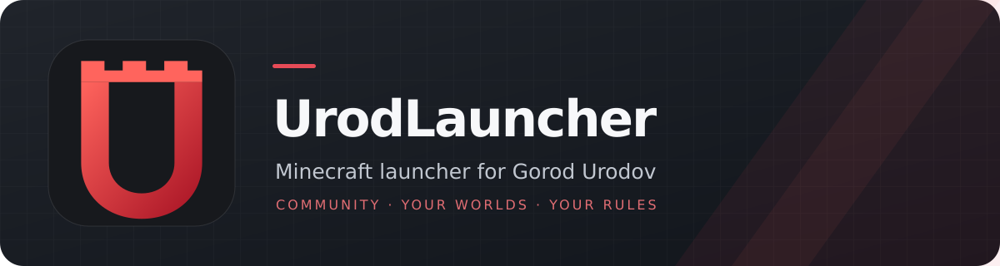
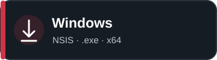
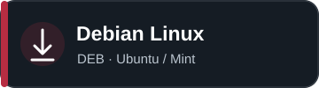
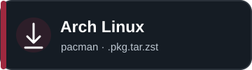
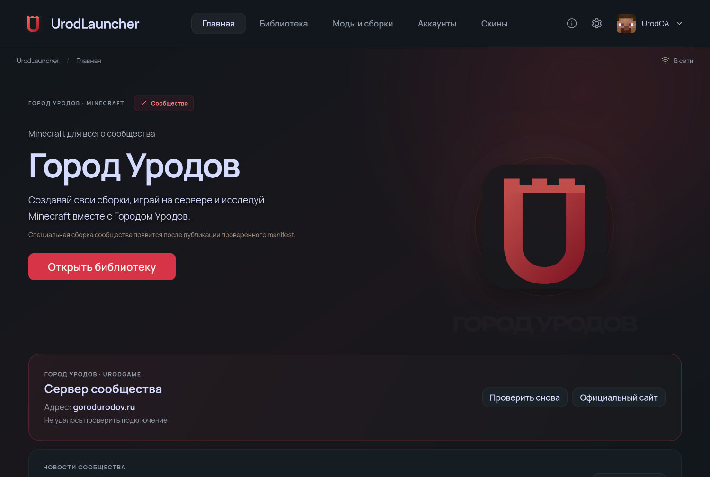
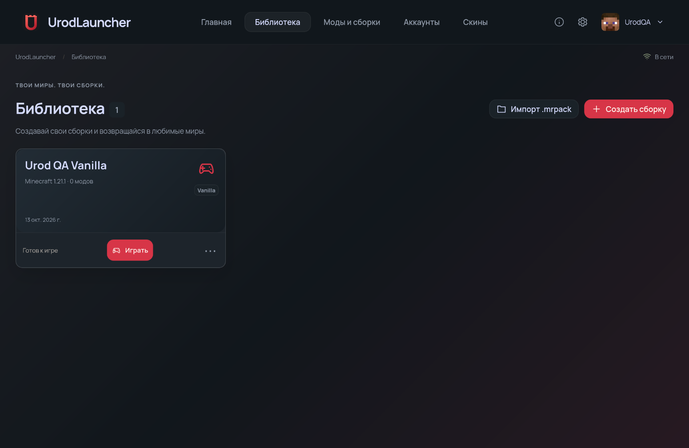
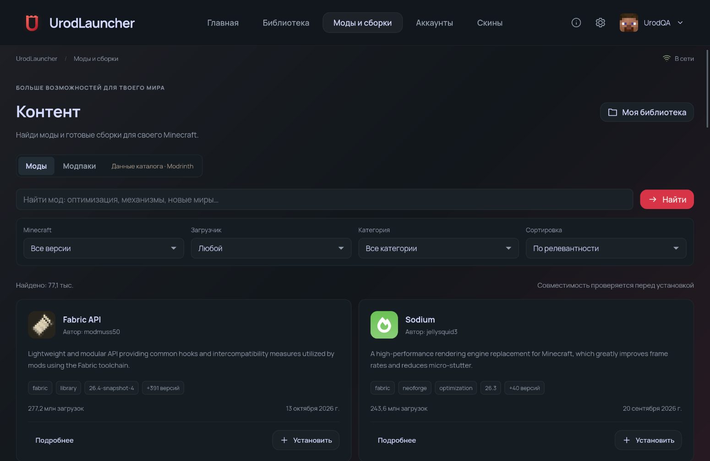
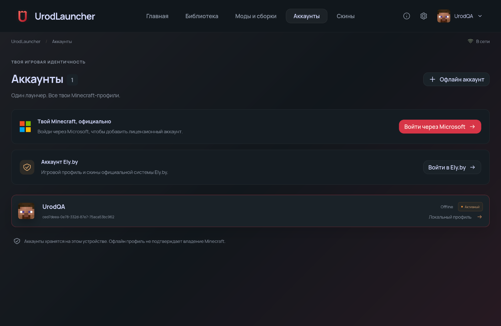
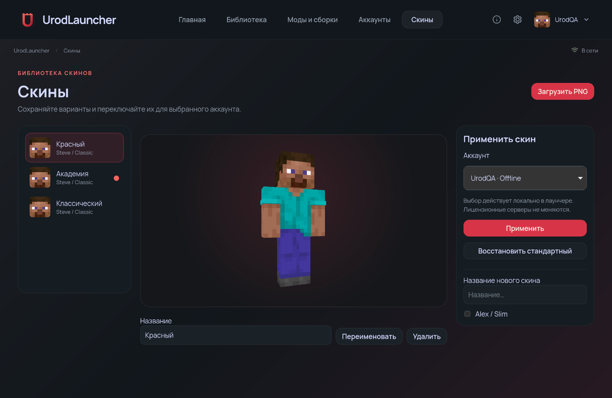
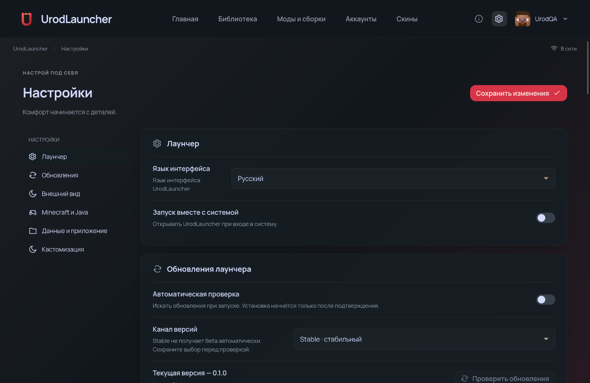

<p align="center"></p>

<p align="center">An independent Minecraft launcher built with Tauri 2, Rust and Vue 3 for the whole <a href="https://gorodurodov.ru">Gorod Urodov</a> community and your own worlds.</p>

<p align="center">
  <a href="README.md">Русский</a> ·
  <a href="https://github.com/Yozekkk/urod-launcher/actions/workflows/check.yml"></a>
  <a href="LICENSE"></a>
  <a href="https://github.com/Yozekkk/urod-launcher/releases"></a>
</p>

<p align="center">
  <a href="https://github.com/Yozekkk/urod-launcher/releases"></a>
  <a href="https://github.com/Yozekkk/urod-launcher/releases"></a>
  <a href="https://github.com/Yozekkk/urod-launcher/releases"></a>
</p>

> These buttons lead to the release page. Version 0.1.0 installers were built in [GitHub Actions](https://github.com/Yozekkk/urod-launcher/actions/runs/38515455380), but no release has been published; direct release file links are therefore unavailable. Version 0.1.0 is not declared Stable.

<p align="center"></p>

## Features

- Microsoft Minecraft, Ely.by and Offline accounts, with multiple profiles.
- Separate Vanilla, Fabric, Forge, NeoForge and Quilt instances; pack import and export, including `.mrpack`.
- Public Modrinth mod and modpack catalog; Java, memory and JVM settings; downloads and game logs.
- Download integrity checks, managed file updates and rollback where supported by the inherited engine.
- Persistent local PNG skin library with 3D preview and Classic/Slim variants. Applying a skin to a Microsoft account sends it to the official Minecraft Services API from the native process and checks the profile afterwards. This still needs verification with a real licensed account.
- 40 customization controls for themes, colors, background, motion and layout, with presets and JSON import/export. The language control changes the document language and primary navigation; a complete English interface translation remains to be done.
- Community home page, official website link and UrodGame card (`gorodurodov.ru`). The connectivity check tests a TCP connection, not the Minecraft status protocol. News opens the official channel without inventing a feed.

| Library | Catalog |
| --- | --- |
|  |  |
| Accounts | Skins |
|  |  |

<p align="center"></p>

[Customization screen](docs/screenshots/urod-0.1.0/customization.png)

These are screenshots of the native application on EndeavourOS, using a test Offline account and test skins. [Small window](docs/screenshots/urod-0.1.0/home-small.png).

## Installation

Open [Releases](https://github.com/Yozekkk/urod-launcher/releases), choose the package for your OS and compare its SHA-256 hash with `SHA256SUMS.txt` from the same release.

| System | Package | Install after publication |
| --- | --- | --- |
| Windows 10/11 x64 | `UrodLauncher-Setup-0.1.0.exe` | Run the NSIS installer for the current user. |
| Debian, Ubuntu, Linux Mint x64 | `UrodLauncher-0.1.0-amd64.deb` | `sudo apt install ./UrodLauncher-0.1.0-amd64.deb` |
| Arch, EndeavourOS, Manjaro x64 | `UrodLauncher-0.1.0-x86_64.pkg.tar.zst` | `sudo pacman -U ./UrodLauncher-0.1.0-x86_64.pkg.tar.zst` |

The Arch package can also be built from source with the [PKGBUILD](packaging/arch/PKGBUILD) after building the binary. macOS support is not offered.

## Accounts and skins

Microsoft sign-in uses OAuth, Xbox/XSTS and Minecraft Authentication. Ely.by uses its supported authentication flow. An Offline profile is useful in single-player and on servers that allow it; it does not grant a Minecraft license.

In **Skins**, add a 64×64 or 64×32 PNG (up to 1 MB), choose Classic/Steve or Slim/Alex, select an account, then press **Apply**. For Microsoft accounts the native process uploads the PNG to Minecraft Services and verifies the profile response. For Offline accounts, the skin appears locally in the launcher. Uploading to Ely.by from the launcher is not supported yet, and the interface says so. Tokens are not sent to Vue.

## Gorod Urodov

UrodGame server address: `gorodurodov.ru`. A dedicated community pack will appear once a real manifest with verifiable files and versions is published. Until then, users can create ordinary instances and use the launcher without community registration. [Official website](https://gorodurodov.ru).

## FAQ

**Why is the community pack unavailable?** No manifest has been supplied yet. The launcher does not reuse the NCreate Server pack or invent Minecraft versions and mods.

**How are launcher updates handled?** The inherited signed updater and Stable/Beta channel structure remain, but UrodLauncher automatic updates are disabled until its own signing key and endpoint exist. Install verified packages manually.

**Are NCreate profiles imported?** No. UrodLauncher has its own app identifier, data directory and credential store.

**Where are friends and chat?** Only models and a future API interface exist. No working social service is claimed. See the [contract](docs/SOCIAL-API.md).

## Requirements and source build

Use Windows 10/11 x64 or a modern Linux x64 system, with access to authentication and download endpoints. Starting Minecraft requires a compatible Java version. Linux requires WebKitGTK 4.1; package dependencies are listed in CI and the PKGBUILD.

```bash
git clone https://github.com/Yozekkk/urod-launcher.git
cd urod-launcher
pnpm install --frozen-lockfile
pnpm prepr:frontend:app
cargo check --locked -p urod-launcher -p urod-app-lib -p urod-launcher-core --all-targets
pnpm app:dev
```

Build packages with `pnpm app:build --bundles deb` on Debian/Ubuntu or `pnpm app:build --bundles nsis` on Windows. On Arch, run `pnpm app:build --no-bundle` and then `makepkg -f` in `packaging/arch`. See [RELEASE.md](docs/RELEASE.md) for CI and release requirements.

## License and attribution

UrodLauncher derives from [NCreate Launcher](https://github.com/Yozekkk/ncreate-launcher), which includes modified portions of the [Modrinth App](https://github.com/modrinth/code). The skin manager approach was studied from the open-source [Millida Launcher](https://github.com/millida/launcher); Millida infrastructure is not used. Source is distributed under [GPL-3.0-only](LICENSE). Attribution and font notices: [NOTICE.md](NOTICE.md), [COPYING.md](COPYING.md), [art provenance](apps/app-frontend/public/brand/PROVENANCE.md). This project is not affiliated with Mojang or Microsoft.
