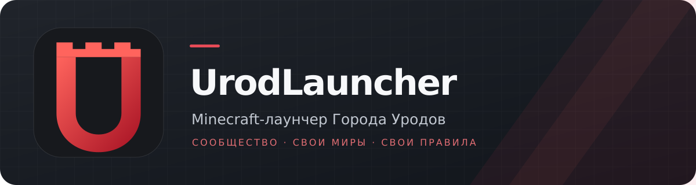

<p align="center"></p>

<p align="center">Самостоятельный Minecraft-лаунчер на Tauri 2, Rust и Vue 3 для всего сообщества <a href="https://gorodurodov.ru">Города Уродов</a> и любых собственных миров.</p>

<p align="center">
  <a href="README.en.md">English</a> ·
  <a href="https://github.com/Yozekkk/urod-launcher/actions/workflows/check.yml"></a>
  <a href="LICENSE"></a>
  <a href="https://github.com/Yozekkk/urod-launcher/releases"></a>
</p>

<p align="center">
  <a href="https://github.com/Yozekkk/urod-launcher/releases"></a>
  <a href="https://github.com/Yozekkk/urod-launcher/releases"></a>
  <a href="https://github.com/Yozekkk/urod-launcher/releases"></a>
</p>

> Кнопки ведут на страницу релизов. Сборки установщиков 0.1.0 доступны через [GitHub Actions](https://github.com/Yozekkk/urod-launcher/actions/workflows/check.yml) после успешного выполнения проверки. Релиз ещё не опубликован; поэтому прямых ссылок на файлы релиза нет. Версия 0.1.0 не объявлена Stable.

<p align="center"></p>

## Возможности

- Аккаунты Microsoft Minecraft, Ely.by и Offline, переключение между несколькими профилями.
- Отдельные инстансы Vanilla, Fabric, Forge, NeoForge и Quilt; импорт и экспорт сборок, включая `.mrpack`.
- Поиск модов и модпаков через публичный каталог Modrinth, управление Java, памятью и параметрами JVM, загрузками и логами.
- Проверка целостности загрузок, обновление управляемых файлов и откат там, где это поддерживает исходная система.
- Локальная библиотека PNG-скинов с трёхмерным просмотром, вариантами Classic/Slim и сохранением между запусками. Для Microsoft-аккаунта действие «Применить» обращается к официальному Minecraft Services API с токеном, остающимся в нативном процессе. Реальная смена лицензионного скина требует входа в действительный аккаунт и отдельной проверки.
- 40 элементов кастомизации: темы, цвета, фон, анимации, плотность и компоновка, пресеты, импорт и экспорт JSON. Переключатель языка меняет язык документа и основных элементов навигации; полный перевод интерфейса ещё не завершён.
- Главная страница сообщества, ссылка на официальный сайт и карточка UrodGame (`gorodurodov.ru`). Проверка подключения показывает доступность TCP-соединения, а не статус игрового протокола. Новости открываются по ссылке на официальный канал, без выдуманной ленты.

| Библиотека | Каталог |
| --- | --- |
|  |  |
| Аккаунты | Скины |
|  |  |

<p align="center"></p>

[Экран кастомизации](docs/screenshots/urod-0.1.0/customization.png)

Снимки сделаны в нативном приложении на EndeavourOS с тестовым Offline-аккаунтом и тестовыми скинами. [Небольшое окно](docs/screenshots/urod-0.1.0/home-small.png).

## Установка

Откройте [Releases](https://github.com/Yozekkk/urod-launcher/releases), выберите пакет для своей системы и сверяйте SHA-256 с `SHA256SUMS.txt` того же выпуска.

| Система | Пакет | Установка после публикации |
| --- | --- | --- |
| Windows 10/11 x64 | `UrodLauncher-Setup-0.1.0.exe` | Запустите NSIS-установщик от своего пользователя. |
| Debian, Ubuntu, Linux Mint x64 | `UrodLauncher-0.1.0-amd64.deb` | `sudo apt install ./UrodLauncher-0.1.0-amd64.deb` |
| Arch, EndeavourOS, Manjaro x64 | `UrodLauncher-0.1.0-x86_64.pkg.tar.zst` | `sudo pacman -U ./UrodLauncher-0.1.0-x86_64.pkg.tar.zst` |

Arch-пакет также можно собрать из исходников через [PKGBUILD](packaging/arch/PKGBUILD) после сборки бинарного файла. Поддержка macOS не заявлена.

## Аккаунты и скины

Microsoft-вход использует OAuth, Xbox/XSTS и Minecraft Authentication. Ely.by работает через собственный поддерживаемый механизм. Offline-профиль полезен для одиночной игры и серверов, допускающих его; он не даёт лицензию Minecraft.

В разделе **Скины** добавьте PNG 64×64 или 64×32 (не более 1 МБ), укажите Classic/Steve либо Slim/Alex, выберите аккаунт и нажмите **Применить**. Для Microsoft-аккаунта лаунчер отправляет PNG в Minecraft Services и проверяет профиль после ответа. Для Offline-аккаунта скин виден локально в лаунчере. Загрузка на Ely.by через приложение пока не поддерживается; интерфейс сообщает об этом явно. Токены не передаются во Vue.

## Город Уродов

Адрес сервера UrodGame: `gorodurodov.ru`. Специальная сборка сообщества появится после публикации настоящего manifest с проверяемыми файлами и версиями. До этого можно создавать обычные инстансы и использовать все остальные возможности без регистрации в сообществе. [Официальный сайт](https://gorodurodov.ru).

## Частые вопросы

**Почему нельзя установить сборку сообщества?** Её manifest пока не предоставлен. Лаунчер не подставляет сборку NCreate Server и не придумывает версии или моды.

**Как работают обновления лаунчера?** Механизм подписи и каналы Stable/Beta сохранены в исходной архитектуре, но автообновление UrodLauncher выключено, пока нет собственного ключа подписи и опубликованного endpoint. Устанавливайте проверенные пакеты вручную.

**Переносятся ли профили NCreate?** Нет. UrodLauncher использует собственный идентификатор приложения, каталог данных и хранилище секретов.

**Где друзья и чат?** Подготовлены только типы и интерфейс будущего API; работающий социальный сервис не заявлен. См. [контракт](docs/SOCIAL-API.md).

## Требования и сборка

Нужны Windows 10/11 x64 или современный Linux x64, доступ к серверам авторизации и загрузок, а для запуска игры — Java совместимой версии. На Linux требуется WebKitGTK 4.1; зависимости пакетов описаны в CI и PKGBUILD.

```bash
git clone https://github.com/Yozekkk/urod-launcher.git
cd urod-launcher
pnpm install --frozen-lockfile
pnpm prepr:frontend:app
cargo check --locked -p urod-launcher -p urod-app-lib -p urod-launcher-core --all-targets
pnpm app:dev
```

Для пакетов: `pnpm app:build --bundles deb` на Debian/Ubuntu, `pnpm app:build --bundles nsis` на Windows; на Arch сначала `pnpm app:build --no-bundle`, затем `makepkg -f` в `packaging/arch`. Команды CI и требования к выпуску описаны в [RELEASE.md](docs/RELEASE.md).

## Лицензия и авторство

UrodLauncher основан на [NCreate Launcher](https://github.com/Yozekkk/ncreate-launcher), который содержит модифицированные части [Modrinth App](https://github.com/modrinth/code). Подход к менеджеру скинов изучен по открытому коду [Millida Launcher](https://github.com/millida/launcher); инфраструктура Millida не используется. Код распространяется по [GPL-3.0-only](LICENSE). Уведомления об авторах, происхождении и шрифтах: [NOTICE.md](NOTICE.md), [COPYING.md](COPYING.md), [provenance графики](apps/app-frontend/public/brand/PROVENANCE.md). Проект не связан с Mojang или Microsoft.
