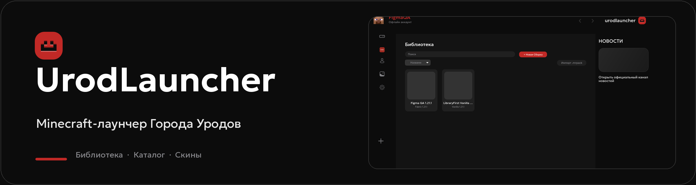

<strong>Сборки, контент и скины в одном лаунчере для Города Уродов и собственных миров.</strong>

<a href="README.en.md">English</a> · <a href="docs/FIGMA_IMPLEMENTATION_MAP.md">Дизайн из Figma</a> · <a href="docs/TEST-REPORT.md">Результаты тестов</a>

> **Состояние проекта:** 0.1.0 Development. Интерфейс переносится из Figma; выпуск 1.0.0 Stable пока заблокирован оставшимися проверками. [Аудит готовности](docs/STABLE_1.0.0_AUDIT.md).

## Тестовые пакеты

  
  
  

Кнопки открывают [успешную сборку GitHub Actions](https://github.com/Yozekkk/urod-launcher/actions/runs/40458957014). Внизу страницы откройте **Artifacts**: <code>windows-installer</code>, <code>debian-package</code> или <code>arch-package</code>. GitHub может потребовать вход; CI-артефакты хранятся ограниченное время. Это пакеты **0.1.0 Development**, а не выпущенный Stable Release. Страница постоянных выпусков — [Releases](https://github.com/Yozekkk/urod-launcher/releases).

## Библиотека — стартовый экран

При каждом запуске открывается Библиотека. В ней можно создать сборку, выбрать Vanilla, Fabric, Forge, NeoForge или Quilt, установить Minecraft, запустить игру и остановить процесс. Поиск, сортировка, импорт и экспорт сборок доступны из этого же раздела.

Снимок 1280×720 сделан с работающего Tauri-приложения в изолированном тестовом профиле. Пустые обложки соответствуют сборкам без пользовательских иконок.

## Возможности

| Каталог | Аккаунты |
| --- | --- |
|  |  |
| Поиск модов, шейдеров, наборов ресурсов и сборок через Modrinth. Совместимость проверяется по версии Minecraft и загрузчику. | Microsoft, Ely.by и Offline. Можно хранить несколько профилей и переключаться между ними. Live-вход без разрешённых учётных данных не заявлен как проверенный. |

У выбранной сборки доступны управление установленным контентом, журнал запуска, настройки Java и памяти. Движок проверяет хеши загрузок, поддерживает отмену операций и восстановление там, где это предусмотрено архитектурой.

## Скины

Добавьте PNG 64×64 или 64×32 размером до 1 МБ, выберите Classic/Steve либо Slim/Alex, поверните 3D-модель, переименуйте скин или замените текстуру. История применения хранится на диске отдельно для каждого аккаунта.

Посмотреть историю скинов

Для Offline-аккаунта скин применяется локально в лаунчере. Для Microsoft нативный процесс отправляет PNG в Minecraft Services и проверяет ответ профиля; успешная работа с реальным аккаунтом пока не подтверждена. Загрузка скина на Ely.by из приложения недоступна.

## Настройки и кастомизация

| Настройки по Figma | Дополнительная кастомизация |
| --- | --- |
|  |  |

Глобальные настройки включают обнаружение Java, параметры памяти и окна, управление ресурсами и лимит одновременных загрузок. Отдельные сборки могут переопределять Java и размер окна. В дополнительном редакторе доступны 37 элементов кастомизации; ещё три поля старой главной страницы читаются для совместимости с сохранёнными настройками. Значения сохраняются после перезапуска. Неподдерживаемые синхронизация, команды запуска и отдельные параметры честно отключены в интерфейсе.

## Установка

Скачайте нужный CI-артефакт по кнопкам выше и распакуйте архив GitHub Actions. Названия пакетов, проверенные в этом запуске:

| Платформа | Файл | Команда |
| --- | --- | --- |
| Windows 10/11 x64 | <code>UrodLauncher-Setup-0.1.0.exe</code> | Запустите NSIS-установщик. Исполнение в настоящей Windows ещё не проверено. |
| Debian / Ubuntu / Linux Mint x64 | <code>UrodLauncher-0.1.0-amd64.deb</code> | <code>sudo apt install ./UrodLauncher-0.1.0-amd64.deb</code> |
| Arch / EndeavourOS / Manjaro x64 | <code>UrodLauncher-0.1.0-x86_64.pkg.tar.zst</code> | <code>sudo pacman -U ./UrodLauncher-0.1.0-x86_64.pkg.tar.zst</code> |

Для сборки из исходников нужны Node.js, pnpm, Rust и системные библиотеки Tauri. На Linux требуется WebKitGTK 4.1. Инструкции: [DEVELOPMENT.md](docs/DEVELOPMENT.md) и [RELEASE.md](docs/RELEASE.md). Автообновление UrodLauncher безопасно отключено до появления собственного ключа подписи и endpoint.

## Частые вопросы

Нужна ли лицензия Minecraft для Offline-профиля?

Offline-профиль подходит для одиночной игры и серверов, допускающих такой вход. Он не предоставляет лицензию Minecraft.

Можно ли установить сборку сообщества?

Проверенный manifest сборки «Города Уродов» пока не опубликован. Свои сборки создавать и запускать можно.

Сохраняются ли аккаунты, скины и настройки?

Да. Изолированный нативный тест прошёл 20 запусков с 10 Offline-аккаунтами, 15 скинами, раздельной историей и 40 сохранёнными значениями настроек. Live-сценарии Microsoft и Ely.by остаются в списке ограничений. Подробности: <a href="docs/TEST-REPORT.md">отчёт о тестировании</a>.

## Документация и лицензия

[Карта переноса Figma](docs/FIGMA_IMPLEMENTATION_MAP.md) · [Дизайн-система](docs/DESIGN_SYSTEM.md) · [Тестирование](docs/TESTING.md) · [Аудит безопасности](docs/SECURITY_REVIEW.md) · [Происхождение графики](docs/GRAPHICS_AUDIT.md)

UrodLauncher основан на [NCreate Launcher](https://github.com/Yozekkk/ncreate-launcher) с модифицированными компонентами [Modrinth App](https://github.com/modrinth/code). Код распространяется по [GPL-3.0-only](LICENSE); обязательные сведения об авторах и лицензиях сохранены в [NOTICE.md](NOTICE.md) и [COPYING.md](COPYING.md). Проект не связан с Mojang или Microsoft.
